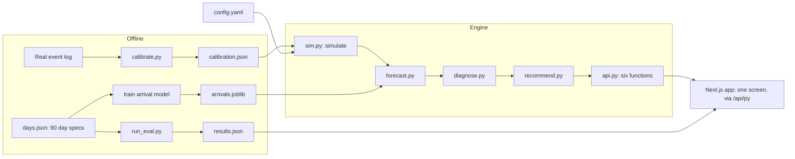
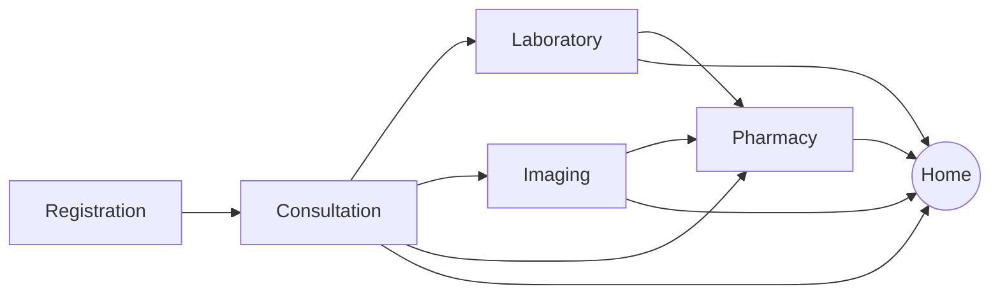

# Technical Requirements Document: Service Bottleneck Predictor

**Prototype use case:** Hospital outpatient services
**Status:** Draft v1, 10 October 2026
**Related docs:** [PRD.md](PRD.md) (what and why), [DESIGN.md](DESIGN.md) (screen and copy)

---

## 1. Architecture

A Next.js front end talks to one Python engine through a small stateless API (`api/index.py`). The browser holds the replay clock and the applied moves and asks for the screen at each step; the engine is deterministic, so there is no database and no server-side session.



The central design choice: **one forward simulator is used three ways.**

| Use | How the simulator is called |
| --- | --- |
| Forecast (Detect) | Run forward 60 minutes from the current state, 30 times |
| Cause (Categorize) | Run forward again with one driver reset to normal |
| What-if (Recommend) | Run forward again with one staff move applied |

## 2. Technology

| Layer | Choice | Reason |
| --- | --- | --- |
| Language | Python 3.11 or later | One language for engine and app |
| Front end | Next.js (App Router), Tailwind CSS, shadcn/ui, Framer Motion | Standard production web stack; full control over the look |
| API | FastAPI | Thin, typed wrapper around `engine/api.py`; runs as a Vercel Python function |
| Simulator | Plain Python minute-step loop with NumPy | Fast, repeatable from a seed, can start from any mid-day state |
| Learned model | scikit-learn `HistGradientBoostingRegressor(loss="poisson")` | No extra install; suited to count targets |
| Data handling | pandas | Calibration and evaluation |
| Charts | Plain HTML and CSS bars | Small bars inside the Why? disclosure only |
| Config | YAML via PyYAML | Every tunable value in one file |
| Hosting | Vercel | Front end and Python function in one deployment |

SimPy is not used: starting a discrete-event simulation from a mid-day state is awkward, and the engine needs that constantly.

`requirements.txt` (deployed): `fastapi`, `numpy`, `scikit-learn`, `pyyaml`. `requirements-dev.txt` adds `uvicorn`, `pandas`, `pytest`, `httpx`. Pin to the versions installed locally.

## 3. Repository layout

```text
config.yaml
requirements.txt
README.md
docs/
  PRD.md
  TRD.md
  DESIGN.md
engine/
  api.py         the six functions the app imports
  mock.py        fake outputs in the agreed shapes
  sim.py         simulate(), scenarios, day generation
  calibrate.py   real log -> data/calibration.json
  forecast.py    arrival model, forecast(), alert rule
  diagnose.py    diagnose(), priority score
  recommend.py   recommend(), alerts()
api/
  index.py       FastAPI: /api/py/health, /api/py/meta, /api/py/screen
presenter/
  view.py        cached engine calls -> display models
  wording.py     sentence templates
src/             Next.js front end (app/, components/, hooks/, lib/)
vercel.json      Python function settings
data/
  days.json          90 day specs
  calibration.json   derived from the real log
  demo_days.json     the four named demo days
models/
  arrivals.joblib
eval/
  run_eval.py
  results.json
tests/
  test_contract.py
```

**Import rule:** the app imports only from `engine/api.py`. Initially `api.py` re-exports the fakes in `mock.py`; each is swapped for the real function as it lands, so app imports never change.

## 4. Configuration

```yaml
open: "08:00"
close: "16:00"
tick_min: 5
wait_limit_min: 30
arrivals_per_hour: {default: 12, peak: 22, peak_from: "09:00", peak_to: "11:00"}
stations:
  registration: {staff: 2, service_min: 4,  share: 1.00, weight: 1.0}
  consultation: {staff: 4, service_min: 10, share: 1.00, weight: 1.5}
  laboratory:   {staff: 1, service_min: 6,  share: 0.35, weight: 1.0}
  imaging:      {staff: 1, service_min: 12, share: 0.15, weight: 1.0}
  pharmacy:     {staff: 2, service_min: 7,  share: 0.65, weight: 1.2}
alert: {raise_at: 0.60, clear_at: 0.40, ticks: 2}
forecast: {runs: 30, horizons_min: [15, 30, 60]}
allowed_moves:   # assumption: a moved staff member works at full speed
  - {id: clerk_to_pharmacy, from: registration, to: pharmacy,
     label: "Move one registration clerk to the pharmacy counter"}
  - {id: nurse_to_lab, from: float, to: laboratory,
     label: "Send the float nurse to laboratory sample-taking"}
  - {id: open_reserve_room, from: float, to: consultation,
     label: "Open the reserve room with the on-call doctor"}
  - {id: open_third_desk, from: float, to: registration,
     label: "Open a third registration desk with the float clerk"}
  - {id: fast_track_pharmacy, station: pharmacy, service_scale: 0.8,
     label: "Fast-track repeat prescriptions at pharmacy"}
```

- `data/calibration.json`, when present, overrides `arrivals_per_hour`, `service_min` and `share`.
- `alert` thresholds are tuned on the tuning days. `weight` values are a stated judgment.
- A move with `from: float` has no donor station and so no donor cost.

## 5. Domain model

### Stations and pathways



Every patient registers and sees a doctor. After consultation a patient may go to laboratory, imaging, both, or neither, then to pharmacy or home. Routing probabilities are set so that station shares match the configuration.

Starting capacity, before calibration:

| Station | Staff | Service time | Share of patients | Capacity per hour | Busy at peak |
| --- | --- | --- | --- | --- | --- |
| Registration | 2 | 4 min | 100% | 30 | 73% |
| Consultation | 4 | 10 min | 100% | 24 | 92% |
| Laboratory | 1 | 6 min | 35% | 10 | 77% |
| Imaging | 1 | 12 min | 15% | 5 | 66% |
| Pharmacy | 2 | 7 min | 65% | 17 | 83% |

Peak is 22 arrivals per hour. A normal day has about 116 patients.

### State

```python
state = {
    "day": int,
    "clock": int,                 # minutes since midnight
    "actions": tuple,             # applied actions, each (action_id, start_minute)
    "stations": {
        name: {
            "waiting": int,           # patients in the queue
            "in_service": int,
            "staff_on": int,
            "wait_now_min": float,    # see wait estimate below
            "arrivals_30m": int,      # joined this station in the last 30 minutes
            "service_min_30m": float  # average service time over the last 30 minutes
        }
    }
}
```

Internally the simulator also holds each queue (visit ID and minute joined) and each staff member's busy-until minute.

### Wait estimate

One definition is used for "wait now" and for every forecast:

```
wait estimate (minutes) = patients waiting × average service time ÷ staff on duty
```

A **breach** is this estimate above `wait_limit_min`.

## 6. Data

### Sources

| Source | Role |
| --- | --- |
| HospitalOPD event log (Mendeley Data, DOI 10.17632/j2hd2239dr.1) | Calibration: arrival shape by hour and weekday, service-time mean and spread per station, pathway shares |
| HospitalOPD Bottleneck Labelled (Mendeley Data) | Optional cross-check of breach detection |
| Simulated days | Training, tuning, testing, what-ifs, policy comparison |

### Data check before use

| Check | If it fails |
| --- | --- |
| Each row has a visit or patient ID and an activity name | Use configuration assumptions only |
| Start and completion times present to the minute | Keep configured service times |
| Wait derivable as this start minus previous completion | Skip the real-data wait check |
| A staff or resource column exists | Keep staff numbers as assumptions |
| Some days are busy enough to form queues | Calibrate only, scale arrivals, state the factor |
| Licence allows reuse with attribution | Do not commit the file; commit only derived summary numbers |

### Simulated event log schema

One row per visit to a station:

| Column | Type | Meaning |
| --- | --- | --- |
| `day` | int | Day index |
| `visit_id` | str | One patient visit |
| `station` | str | One of the five stations |
| `arrive_ts` | HH:MM | Joined the station's queue |
| `start_ts` | HH:MM | Service started |
| `end_ts` | HH:MM | Service finished |
| `staff_id` | str | Who served |
| `scenario` | str | `normal`, `demand_surge`, `staffing_gap`, `slow_processing` |

Logs are not committed. Only the day specs are stored, and days are re-simulated on demand.

### Day specs and splits

`data/days.json` holds 90 entries of `{day, seed, weekday, scenario}`.

| Set | Days | Use |
| --- | --- | --- |
| Train | 60 | Fit the arrival forecaster and time-of-day averages |
| Tune | 10 | Choose alert thresholds |
| Test | 20 | All reported results; never used for tuning |

Mix: 42 normal days and 16 of each scenario type, with every type present in every split.

### Scenarios

| Type | Injection |
| --- | --- |
| Demand surge | Arrivals × 1.6 to 2.0 for 60 to 90 minutes |
| Staffing gap | One fewer staff at a station for 120 minutes |
| Slow processing | Service time × 1.5 at a station for 60 to 90 minutes |

A scenario is `{type, station, start, duration, strength}`.

## 7. Engine

### 7.1 Simulator

```python
simulate(state, minutes, arrival_rate_fn, staff, service_scale, seed) -> (new_state, visit_rows)
```

Each simulated minute, in order:

1. Draw new arrivals at registration from a Poisson distribution at that minute's rate.
2. At each station, finish any service whose end time has passed and route the patient onward.
3. At each station, assign free staff to the patients who have waited longest and draw a service time for each.

- Service times are lognormal, with the mean from configuration and a spread of about half the mean until calibration replaces it.
- One `numpy.random.default_rng(seed)` per run, passed to every draw.
- Sanity checks: about 116 patients on a normal day, consultation about 90% busy at peak, no negative waits, every patient either finishes or is still present at close.

### 7.2 Arrival forecaster

- **Rows:** one per 5-minute tick of the 60 training days.
- **Target:** registration arrivals in each of the next four 15-minute buckets.
- **Features:** minute of day, weekday, arrivals in the last 15, 30 and 60 minutes, and each of those divided by the usual level for that time.
- **Model:** `HistGradientBoostingRegressor(loss="poisson")`, saved to `models/arrivals.joblib`.

The model exists because on a surge day the time-of-day average is wrong; the model picks up the surge from recent arrivals. Arrivals at downstream stations are not modelled directly: they come out of the simulation.

### 7.3 Forecast

`forecast(state)` runs 30 forward simulations of 60 minutes with:

- arrivals from the forecaster,
- staff from the current state,
- service speed as the last 30 minutes' average divided by the usual, clipped to 0.7–2.0.

Per station and horizon it reports the median (`wait_p50`) and 90th percentile (`wait_p90`) of the wait estimate, and `breach_prob` as the share of runs above the limit.

### 7.4 Alert rule

- **Raise** when `breach_prob` at 30 or 60 minutes is at or above `raise_at` on two consecutive ticks.
- **Clear** when it is below `clear_at` on two consecutive ticks.
- The previous tick is obtained by calling `get_state()` at `clock - 5`; caching makes this cheap.
- `patients_affected` = patients waiting now plus those expected to join in the next 60 minutes.
- `minutes_to_breach` = the first 5-minute step at which the median run passes the limit.

Thresholds are chosen on the tuning days by sweeping `raise_at` from 0.4 to 0.8 and picking the setting that catches the most breaches within the false-alarm budget. A false alarm is an alert with no breach within 60 minutes.

### 7.5 Cause attribution

`diagnose(state, station)` re-runs the forecast three times **with the same seeds**, each time resetting one driver across the whole clinic:

| Re-run | Driver reset | Cause it tests |
| --- | --- | --- |
| A | Arrivals set to the usual level for the time of day | `demand_surge` |
| B | Staff set to the roster | `staffing_gap` |
| C | Service speed set to 1.0 | `slow_processing` |

Contribution = the 60-minute wait at the target station in the original forecast minus the wait in that re-run.

Labelling:

- The largest contribution wins.
- If the second is at least 80% of the first: `mixed`.
- If every contribution is under 3 minutes: `peak_load`.

Shared seeds are essential. Without them the difference between runs is partly chance and the label flickers between ticks.

### 7.6 Priority

```
priority = breach_prob × patients_affected × expected minutes over the limit × station weight
```

Used only to order alerts. It is never shown as a number.

### 7.7 Recommendation

`recommend(state, station)` re-runs the forecast once per allowed move, with the same seeds and the move applied for 60 minutes. Every move is tested, not only those aimed at the alerting station.

Per move it reports:

| Field | Meaning |
| --- | --- |
| `wait_saved_min` | Reduction in the 60-minute wait at the target station |
| `donor_station`, `donor_wait_added_min` | Where the staff member came from and the wait added there |
| `total_wait_saved_patient_min` | Net patient-minutes of waiting saved across all stations |
| `bottleneck_after` | Station with the highest breach probability after the move |

A move is kept only if it saves waiting overall and does not push the donor station into breach. If none qualifies the list is empty, and the app says no allowed move helps.

## 8. API contract

The six functions exported by `engine/api.py`:

```python
get_state(day, clock, actions=()) -> state
# Re-simulates the stored day from its seed, with any applied actions, up to `clock`.

forecast(state) -> {station: {15|30|60: {"wait_p50", "wait_p90", "breach_prob"}}}

diagnose(state, station) -> {
    "cause": "demand_surge" | "staffing_gap" | "slow_processing" | "mixed" | "peak_load",
    "contributions": {"demand_surge": float, "staffing_gap": float, "slow_processing": float}
}

recommend(state, station) -> [{
    "action_id", "label", "wait_saved_min", "donor_station", "donor_wait_added_min",
    "total_wait_saved_patient_min", "bottleneck_after"
}]                                   # best first; may be empty

alerts(state) -> [{
    "station", "breach_prob", "minutes_to_breach", "patients_affected",
    "priority", "cause", "contributions", "top_action"
}]                                   # highest priority first; empty when calm

day_outcome(day, actions=()) -> {"patients", "share_over_30", "total_wait_hours"}
# Whole-day result. Powers "with this action vs without" and the evaluation.
```

Rules:

- All functions are deterministic for the same inputs.
- `get_state` and `day_outcome` are wrapped in `functools.lru_cache`.
- An action is `(action_id, start_minute)` and lasts 60 minutes.
- `top_action` is the first item of `recommend()` or `None`.

## 9. App integration

| Concern | Approach |
| --- | --- |
| Replay clock | `st.session_state.clock`; while playing, wait half a second, add 5 minutes, call `st.rerun()` |
| Applied actions | `st.session_state.actions`, passed to every `get_state()` and `day_outcome()` call |
| Reset | Clears actions and returns the clock to opening time |
| Caching | Engine calls wrapped in `st.cache_data`, keyed by day, clock and actions |
| Errors | Engine calls wrapped so a missing file shows a plain message |
| Evidence | Read once from `eval/results.json` |

Screen structure and wording are specified in [DESIGN.md](DESIGN.md).

## 10. Evaluation

`python eval/run_eval.py` regenerates `eval/results.json`. Runs 1 to 5 use only the 20 test days.

| Run | Question | Output |
| --- | --- | --- |
| 0. Calibration check | Does the simulated clinic resemble the real one? | Service time per station and arrivals per hour, real against simulated normal days |
| 1. Forecast accuracy | Is the forecast better than guessing? | Mean absolute wait error at 30 and 60 minutes for the model and two baselines, split by normal and scenario days |
| 2. Alert quality | Are alerts early and rarely wrong? | Precision, recall, median warning time, false alarms per day with and without the two-tick rule |
| 3. Cause accuracy | Is the cause right? | Confusion table of true against predicted cause |
| 4. Robustness | Does it hold on messy or unfamiliar data? | Runs 1 to 3 under a noisy view, and on two-cause days never seen in training |
| 5. Decision impact | Does acting on it help? | Three policies on the same days and seeds |

**Baselines for run 1:** "wait in 30 minutes equals wait now", and "wait equals the average at this time of day on training days".

**Noisy view for run 4:** queue counts off by up to 2, recent arrivals miscounted by 10%, service times off by 20%. Noise is applied to what the engine observes, not to the underlying day.

**Policies for run 5**, all with the same staff and allowed moves:

| Policy | Rule |
| --- | --- |
| Fixed roster | Nobody moves |
| Reactive | When a station's wait has already passed the limit, send the available move to the station with the longest wait |
| Tool-guided | Apply `top_action` whenever an alert is raised |

Reported per policy: share of patients waiting over 30 minutes, total waiting hours, number of staff moves.

### `results.json` shape

```json
{
  "generated_at": "ISO timestamp",
  "data_mode": "calibrated | assumptions",
  "calibration": {"station": {"real_service_min": 0, "sim_service_min": 0}},
  "forecast": {"30": {"model": 0, "persistence": 0, "time_of_day": 0}, "60": {}},
  "alerts": {"precision": 0, "recall": 0, "median_warning_min": 0,
             "false_alarms_per_day": 0, "false_alarms_per_day_no_rule": 0},
  "cause": {"accuracy": 0, "confusion": {}},
  "robustness": {"noisy": {}, "two_cause": {}},
  "policy": {"fixed": {"share_over_30": 0, "total_wait_hours": 0, "moves": 0},
             "reactive": {}, "tool": {}},
  "assumptions": ["text"]
}
```

Zeros are placeholders for the shape only. No value is reported until it is measured.

## 11. Testing

| Test | What it checks |
| --- | --- |
| `tests/test_contract.py` | Every real function returns the same keys as its mock |
| Simulator sanity | Patient count, peak utilisation, no negative waits, conservation of patients |
| Determinism | Same day, clock and actions give identical state twice |
| Demo days | All four replay from open to close without error |
| Cause check | Each scenario demo day shows its true cause |

## 12. Deployment

1. Push to `main` on GitHub.
2. Vercel builds the Next.js front end and the `api/index.py` Python function from the repo (`npx vercel --prod`, or automatically on push once the repo is connected).
3. Tag the commit at each working checkpoint; redeploy the last tag if a push breaks the app.

Constraints: memory on the free tier is capped and limits can change without notice; idle apps hibernate. Keep committed data small and open the link before presenting.

## 13. Performance budget

| Operation | Budget | If exceeded |
| --- | --- | --- |
| Simulate one full day | Under 1 second | Profile the minute loop |
| `forecast()` | Under 1 second | Drop to 20 runs |
| One replay tick, all calls | Under 2 seconds | Precompute the four demo days into `data/demo_cache.json` |

Each alert costs about nine forecast-sized runs per tick: one forecast, three for cause, five for moves.

## 14. Known limitations

- Results are from simulated days. The simulator is calibrated on one public log where the data allows, not validated against a live clinic.
- Staff numbers and allowed moves are assumptions.
- Cause accuracy can only be measured where the cause is known, which means injected scenarios.
- The wait estimate is a simple formula, not each patient's realised wait.
- A moved staff member is assumed to work at full speed immediately.
- Patients do not abandon the queue in the simulation, so the cost of leaving without care is argued, not measured.

## 15. Ownership

| Area | Owner |
| --- | --- |
| `engine/`, `eval/`, `data/`, `models/`, `config.yaml` | Person A (engine) |
| `src/`, `api/`, `presenter/`, `README.md`, `requirements.txt`, deployment, slides | Person B (app and delivery) |
| API contract | Both; changed only by agreement |
